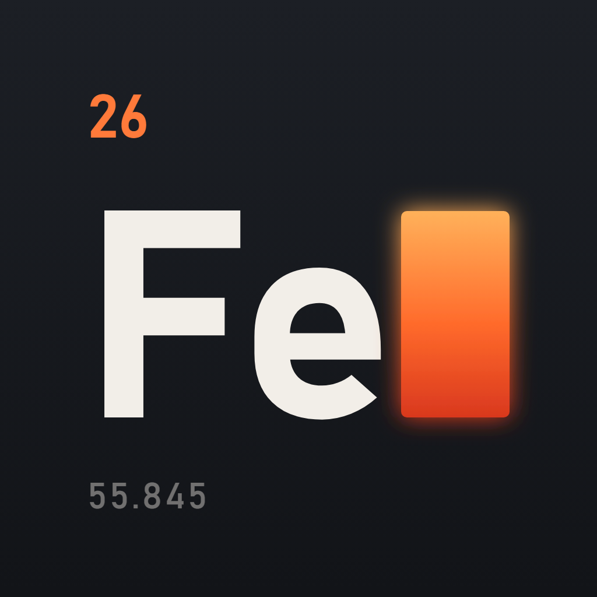

# ferrarolabs

Products built by one person and a team of AI agents.

I decide what to build and approve what ships. Claude Code agents write the code, in their own sessions, through issues, branches and pull requests. The interesting part is the harness around them: what they're told, what checks them, what they can't do, and what gets recorded.

## Repositories

| | |
|---|---|
| [**agent-kit**](https://github.com/ferrarolabs/agent-kit) | The harness, built in the open: the plan, the decisions, and the pieces as they are proven on a real project. |
| [**jamly**](https://github.com/ferrarolabs/jamly) | The pilot: a mobile app for bands, from rehearsal to gig. Expo, TypeScript, Supabase. In development. |

## How work happens here

- **One issue, one branch, one pull request.** Agents never push to `dev`, `staging` or `main`; branch rulesets make sure of it.
- **Agents propose, I decide.** Plans and merges are mine.
- **Every check is seen failing once.** A guardrail that has never blocked anything hasn't been tested.
- **Decisions are written down.** Each repo keeps a decision log or ADRs, so the next session knows why.

The name comes from *Ferraro*: the smith. The mark is iron's tile in the periodic table, with a cursor still hot from the forge.
